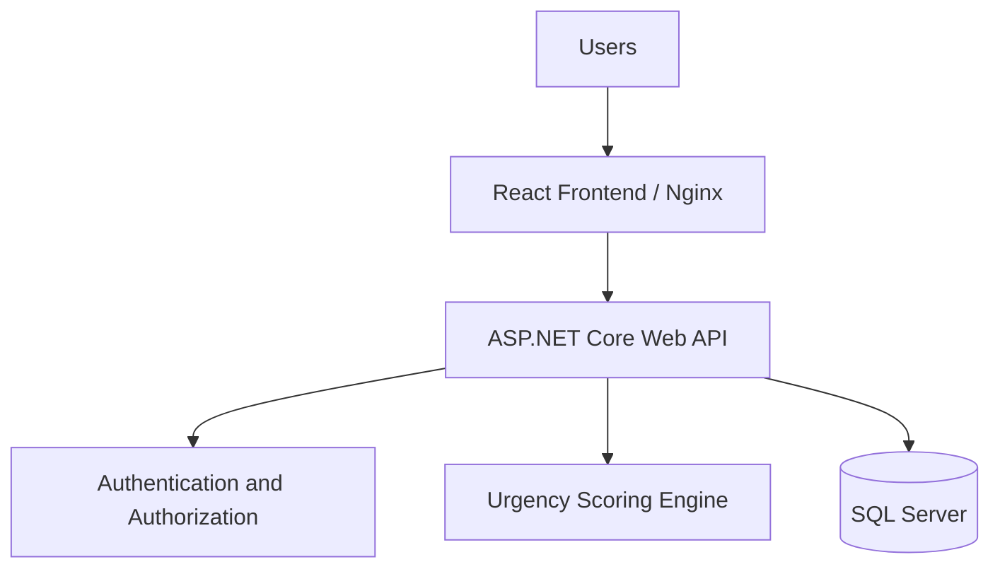
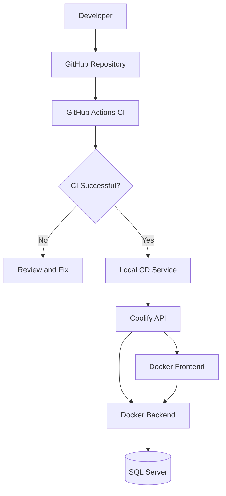

# RescueFlow AI

An intelligent food rescue and redistribution platform connecting food donors, NGOs, volunteers and administrators to reduce food waste.

## Features

- Role-based registration and authentication
- JWT authentication and authorization
- Food donation management
- Rule-based urgency scoring and prioritization
- NGO registration and administrator verification
- Volunteer assignment and pickup management
- Food delivery and rescue completion
- Notifications and impact dashboards

## Technology Stack

| Layer | Technology |
|---|---|
| Frontend | React, TypeScript, Vite |
| Backend | ASP.NET Core Web API, .NET 10 |
| ORM | Entity Framework Core |
| Database | Microsoft SQL Server 2022 |
| Authentication | JWT |
| Web Server | Nginx |
| Containerization | Docker |
| Deployment | Coolify |
| Continuous Integration | GitHub Actions |
| Continuous Deployment | Local systemd deployment service |
| Hosting Environment | Ubuntu WSL2 |

## System Architecture

## User Roles

| Role | Responsibilities |
|---|---|
| Donor | Create and manage food donations |
| NGO | Accept donations and assign volunteers |
| Volunteer | Pick up and deliver food |
| Administrator | Verify NGOs and manage users |

## Donation Lifecycle

Available -> Accepted -> Assigned -> PickedUp -> Delivered -> Completed

## Database

Database name: RescueFlowDB

- Users
- Donations
- NGOProfiles
- NGOAcceptedCategories
- VolunteerAssignments
- PickupTasks
- Notifications

## DevOps Pipeline

The local deployment service checks GitHub Actions every 60 seconds and requests deployment when CI succeeds on the main branch.

## Local Deployment

- Application: http://localhost:8090
- Coolify dashboard: http://localhost:8000
- Backend internal port: 8080
- SQL Server internal port: 1433

The frontend communicates with the backend through an Nginx reverse proxy.

SQL Server uses persistent Docker volume storage.

## Testing Results

The deployment verification completed all seven infrastructure checks.

The end-to-end test completed all twelve workflow stages, including:

- User registration and login
- NGO approval
- Donation creation
- Urgency scoring
- NGO acceptance
- Volunteer assignment
- Pickup and delivery
- Rescue completion
- Dashboard and notification access
- Database persistence

The test donation received an urgency score of 65/100, classified as High, and successfully reached Completed status.

Automatic backend and frontend deployments were also verified.

## Security

- JWT-based authentication
- Role-based authorization
- Password hashing
- Environment-based secret configuration
- Internal Docker networking
- Persistent database storage

Never commit database passwords, JWT signing keys or Coolify API tokens.

## Deployment Limitations

The current deployment is intended for local academic demonstration.

Ubuntu WSL2 and the host computer must remain running for the application and automatic deployment service to operate.

Public hosting, production HTTPS and comprehensive security testing remain future improvements.

## Repository

https://github.com/soumya2321/RescueFlow-AI

## Project Status

Implemented, locally deployed and end-to-end workflow tested.
