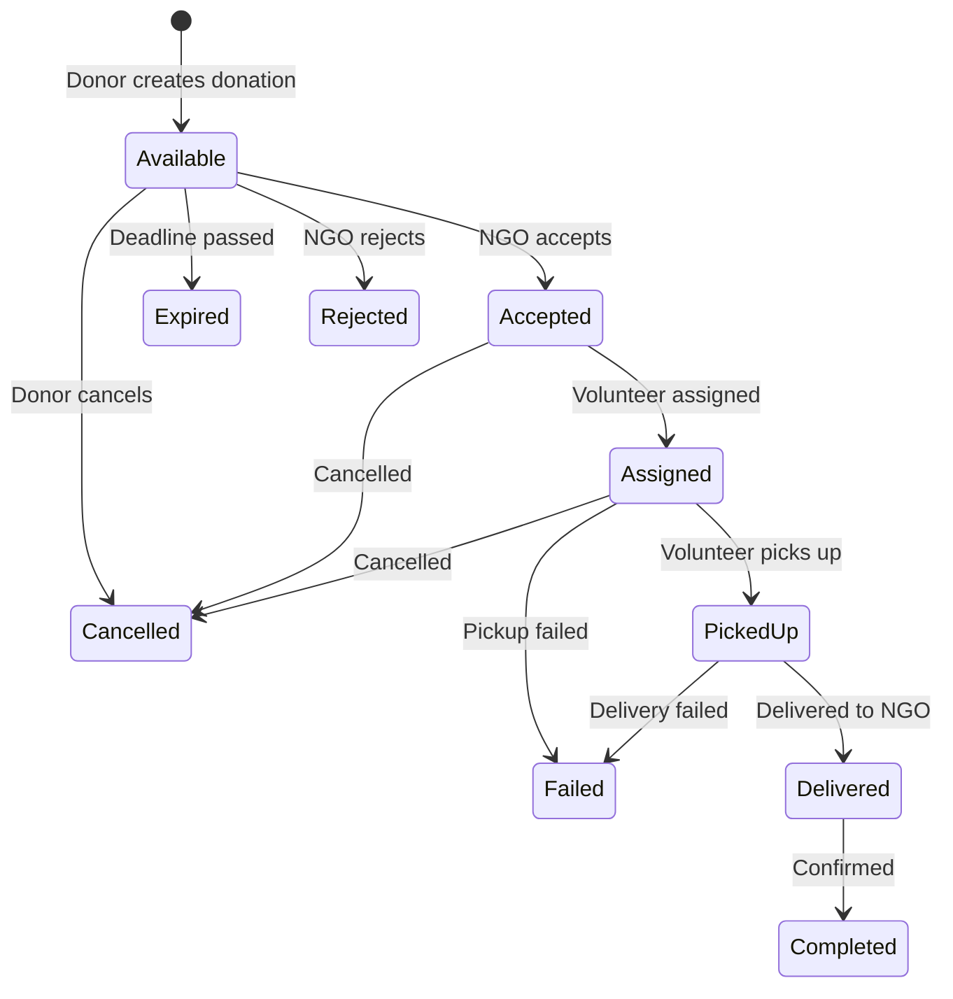
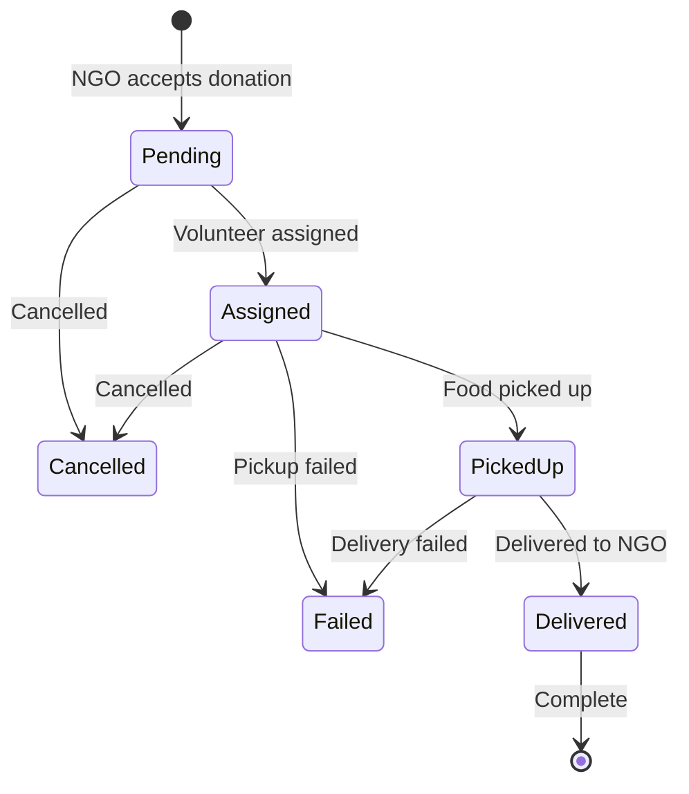

# RescueFlow AI — Entity Relationship Diagram

> This ER diagram shows all 5 tables, their columns, data types, primary keys (PK), foreign keys (FK), and relationships.
>
> **View this on GitHub** or any Markdown viewer that supports Mermaid diagrams.

## ER Diagram

```mermaid
erDiagram
    Users {
        INT UserId PK "IDENTITY(1,1)"
        NVARCHAR FullName "NOT NULL, 100 chars"
        NVARCHAR Email "NOT NULL, UNIQUE, 255 chars"
        NVARCHAR PasswordHash "NOT NULL, 500 chars"
        NVARCHAR Role "NOT NULL, CHECK: Donor/NGO/Volunteer/Admin"
        NVARCHAR Phone "NULLABLE, 20 chars"
        BIT IsActive "NOT NULL, DEFAULT 1"
        DATETIME2 CreatedAt "NOT NULL, DEFAULT SYSDATETIME()"
        DATETIME2 UpdatedAt "NOT NULL, DEFAULT SYSDATETIME()"
    }

    NGOProfiles {
        INT NGOProfileId PK "IDENTITY(1,1)"
        INT UserId FK "NOT NULL, UNIQUE → Users"
        NVARCHAR OrganizationName "NOT NULL, 200 chars"
        DECIMAL MaximumCapacity "NOT NULL, CHECK > 0"
        NVARCHAR CapacityUnit "NOT NULL, 20 chars"
        NVARCHAR Location "NOT NULL, 500 chars"
        BIT IsVerified "NOT NULL, DEFAULT 0"
        DATETIME2 CreatedAt "NOT NULL, DEFAULT SYSDATETIME()"
        DATETIME2 UpdatedAt "NOT NULL, DEFAULT SYSDATETIME()"
    }

    NGOAcceptedCategories {
        INT NGOAcceptedCategoryId PK "IDENTITY(1,1)"
        INT NGOProfileId FK "NOT NULL → NGOProfiles"
        NVARCHAR FoodCategory "NOT NULL, 50 chars"
        BIT IsActive "NOT NULL, DEFAULT 1"
    }

    Donations {
        INT DonationId PK "IDENTITY(1,1)"
        INT DonorId FK "NOT NULL → Users"
        INT RecipientNgoId FK "NULLABLE → Users"
        NVARCHAR FoodName "NOT NULL, 200 chars"
        NVARCHAR FoodCategory "NOT NULL, 50 chars"
        DECIMAL Quantity "NOT NULL, CHECK > 0"
        NVARCHAR Unit "NOT NULL, 20 chars"
        NVARCHAR FoodCondition "NOT NULL, CHECK constraint"
        NVARCHAR StorageType "NOT NULL, CHECK constraint"
        DATETIME2 PickupDeadline "NOT NULL"
        NVARCHAR PickupAddress "NOT NULL, 500 chars"
        NVARCHAR Description "NULLABLE, 1000 chars"
        NVARCHAR Status "NOT NULL, DEFAULT Available"
        DECIMAL UrgencyScore "NOT NULL, CHECK 0-100"
        NVARCHAR UrgencyLevel "NOT NULL, CHECK constraint"
        DATETIME2 CreatedAt "NOT NULL, DEFAULT SYSDATETIME()"
        DATETIME2 UpdatedAt "NOT NULL, DEFAULT SYSDATETIME()"
    }

    VolunteerAssignments {
        INT AssignmentId PK "IDENTITY(1,1)"
        INT DonationId FK "NOT NULL, UNIQUE → Donations"
        INT VolunteerId FK "NOT NULL → Users"
        INT AssignedByNgoId FK "NOT NULL → Users"
        DATETIME2 AssignedAt "NOT NULL, DEFAULT SYSDATETIME()"
        NVARCHAR Status "NOT NULL, CHECK: Assigned/PickedUp/Delivered/Completed/Cancelled"
    }

    PickupTasks {
        INT PickupTaskId PK "IDENTITY(1,1)"
        INT DonationId FK "NOT NULL, UNIQUE → Donations"
        INT NGOId FK "NOT NULL → Users"
        INT VolunteerId FK "NULLABLE → Users"
        DATETIME2 AssignedAt "NULLABLE"
        DATETIME2 ScheduledPickupTime "NULLABLE"
        DATETIME2 ActualPickupTime "NULLABLE"
        DATETIME2 ActualDeliveryTime "NULLABLE"
        NVARCHAR Status "NOT NULL, DEFAULT Pending"
        NVARCHAR Notes "NULLABLE, 1000 chars"
        DATETIME2 CreatedAt "NOT NULL, DEFAULT SYSDATETIME()"
        DATETIME2 UpdatedAt "NOT NULL, DEFAULT SYSDATETIME()"
    }

    Users ||--o| NGOProfiles : "has profile (1:1, NGO only)"
    NGOProfiles ||--o{ NGOAcceptedCategories : "accepts categories (1:N)"
    Users ||--o{ Donations : "creates donations (1:N, Donor only)"
    Users ||--o{ Donations : "recipient NGO (0..1:N)"
    Donations ||--o| VolunteerAssignments : "has assignment (1:0..1)"
    Users ||--o{ VolunteerAssignments : "assigned as Volunteer (1:N)"
    Users ||--o{ VolunteerAssignments : "assigned by NGO (1:N)"
    Donations ||--o| PickupTasks : "has pickup task (1:1, legacy)"
    Users ||--o{ PickupTasks : "accepts as NGO (1:N)"
    Users |o--o{ PickupTasks : "assigned as Volunteer (0..1:N)"
```

## Relationship Summary

| Relationship | Type | Cardinality | Notes |
|---|---|---|---|
| **Users → NGOProfiles** | One-to-One | 1 : 0..1 | Only NGO-role users have a profile. `UserId` in NGOProfiles is UNIQUE. |
| **NGOProfiles → NGOAcceptedCategories** | One-to-Many | 1 : 0..N | Each NGO profile can have many accepted food categories. |
| **Users → Donations (DonorId)** | One-to-Many | 1 : 0..N | A Donor user creates many donations. `DonorId` FK. |
| **Users → Donations (RecipientNgoId)** | One-to-Many (Nullable) | 0..1 : 0..N | An NGO user claims/receives a donation. `RecipientNgoId` FK. |
| **Donations → VolunteerAssignments** | One-to-One | 1 : 0..1 | Each donation has at most one volunteer assignment. `DonationId` is UNIQUE. |
| **Users → VolunteerAssignments (VolunteerId)** | One-to-Many | 1 : 0..N | A volunteer can be assigned to multiple delivery tasks. |
| **Users → VolunteerAssignments (AssignedByNgoId)** | One-to-Many | 1 : 0..N | An NGO can assign multiple delivery tasks to volunteers. |
| **Donations → PickupTasks** | One-to-One (Legacy) | 1 : 0..1 | Legacy pickup task table. `DonationId` is UNIQUE. |
| **Users → PickupTasks (NGOId)** | One-to-Many | 1 : 0..N | Legacy NGO task link. |
| **Users → PickupTasks (VolunteerId)** | One-to-Many (Nullable) | 0..1 : 0..N | Legacy volunteer task link. |

## Status Workflows

### Donation Status Flow

### Pickup Task Status Flow

